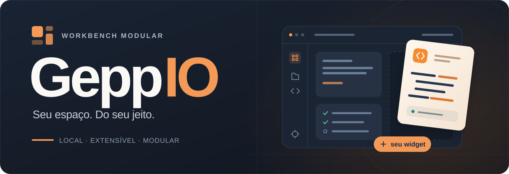

<p align="center">
  
</p>

# GeppIO

**Suas ferramentas, no espaço que você organiza.**

Um aplicativo desktop local que reúne widgets, código e plugins. Monte seu ambiente de trabalho,
salve composições e crie novas ferramentas sobre uma base modular feita com Electron, React e TypeScript.

[Começar](#comece-no-windows) · [Criar plugins](#crie-para-o-geppio) · [Arquitetura](docs/architecture/overview.md) · [Roadmap](https://github.com/rabrunos/GeppIO/issues/2)

> **Em desenvolvimento alpha.** O aplicativo é validado em Windows x64. Outras plataformas ainda fazem parte do planejamento.

## Um espaço, várias possibilidades

- **Organize com widgets.** Mova, redimensione e agrupe ferramentas compatíveis em abas. Use a área principal,
  a lateral e a inferior; salve composições para retomar uma organização.
- **Trabalhe com código.** O GeppIO Code reúne editor Monaco, Explorador de arquivos, busca e
  substituição, Git local e Terminal. Abas e dois grupos de edição compartilham os documentos.
- **Crie suas ferramentas.** Desenvolva interfaces próprias, atualize plugins pela pasta de origem
  e conecte suas funções por permissões explícitas.
- **Leve uma composição para outro app.** O gerador Standalone cria aplicativos Windows x64 com
  notas, contadores e superfícies de plugins selecionadas, com identidade e dados independentes.

## Comece no Windows

Tenha **Node.js 24.x**, **pnpm 11.25.0** e **Git para Windows** instalados.

```powershell
git clone https://github.com/rabrunos/GeppIO.git
cd GeppIO
pnpm install --frozen-lockfile
pnpm run doctor
pnpm dev
```

O primeiro perfil começa vazio: ative plugins e escolha seus widgets no catálogo.
[Experimente os widgets locais](docs/usage/local-widgets.md) ou consulte o
[guia de desenvolvimento](docs/development/local.md) para preparar o ambiente, compilar e testar.

## Crie para o GeppIO

Na **API 3**, a interface usa HTML e CSS, com código em JavaScript ou TypeScript preparado pelo host.
Carregue a pasta em **Modo desenvolvedor**, edite os arquivos e clique em **Atualizar** no aplicativo.
Os exemplos [Quadro](examples/standalone/plugins/board) e [Carimbo](examples/standalone/plugins/stamp)
mostram superfícies próprias e comunicação entre plugins.

Essas superfícies são isoladas e conversam por canais autorizados. Os contratos anteriores, **API 1/2**,
continuam destinados a plugins locais confiáveis. O piloto de pacotes **`.gpp` assinados** verifica
os arquivos e o publicador conforme as chaves autorizadas pelo aplicativo.

[Superfícies e comunicação](docs/architecture/plugin-surfaces.md) · [Pacotes .gpp](docs/architecture/plugin-package.md) · [Gerar um Standalone](src/geppio-standalone/README.md)

## Uma base em seis módulos

| Módulo | Responsabilidade |
| --- | --- |
| [GeppIO](src/geppio) | Aplicativo, áreas de trabalho e serviços nativos. |
| [Runtime](src/geppio-runtime) | Geometria, ativação e contratos compartilhados. |
| [GeppUI](src/geppui/README.md) | Componentes, temas e comportamento visual. |
| [Editor](src/geppio-editor/README.md) | Editor Monaco reutilizável. |
| [Plugin SDK](src/plugin-sdk) | Contratos e comunicação para autores de plugins. |
| [Standalone](src/geppio-standalone/README.md) | Composições em aplicativos independentes. |

GeppUI e Editor podem ser empacotados para uso em outros projetos. Os guias de cada módulo
explicam seus limites e a configuração; a [arquitetura](docs/architecture/overview.md) mostra como se conectam.

## Explore o projeto

- **Para trabalhar no código:** comece pelo [guia do projeto](PROJECT_GUIDE.md).
- **Para acompanhar a evolução:** veja o [roadmap](https://github.com/rabrunos/GeppIO/issues/2),
  as [Issues](https://github.com/rabrunos/GeppIO/issues) e o [changelog](CHANGELOG.md).
- **Para entender dados e limites:** consulte [documentos e recuperação](docs/architecture/documents.md),
  [segurança](docs/architecture/security.md) e [validação](docs/development/testing.md).

**Licença em definição.** O projeto está marcado como `UNLICENSED`; a escolha da licença
é acompanhada na [Issue #60](https://github.com/rabrunos/GeppIO/issues/60).
